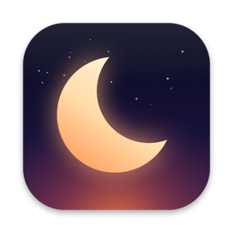
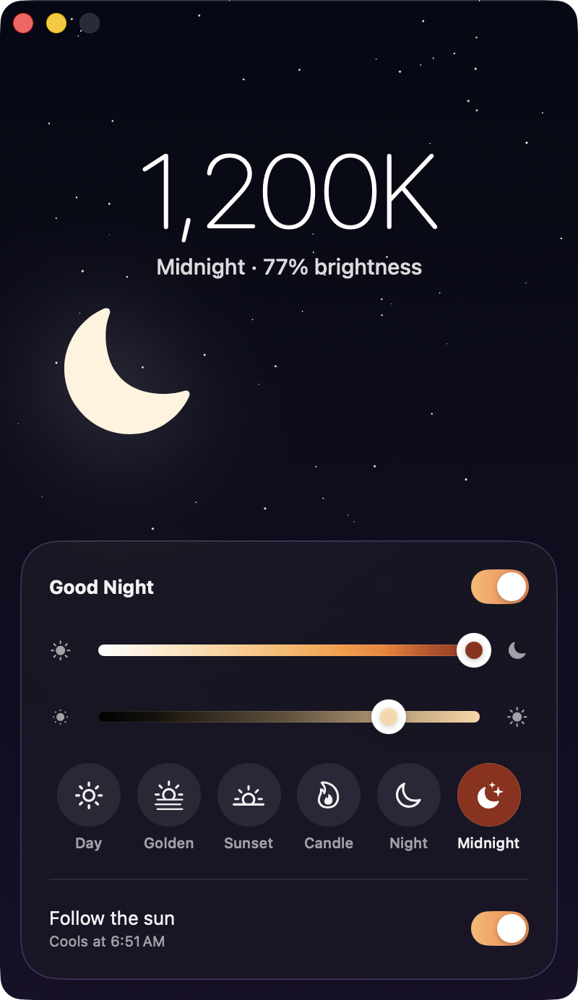
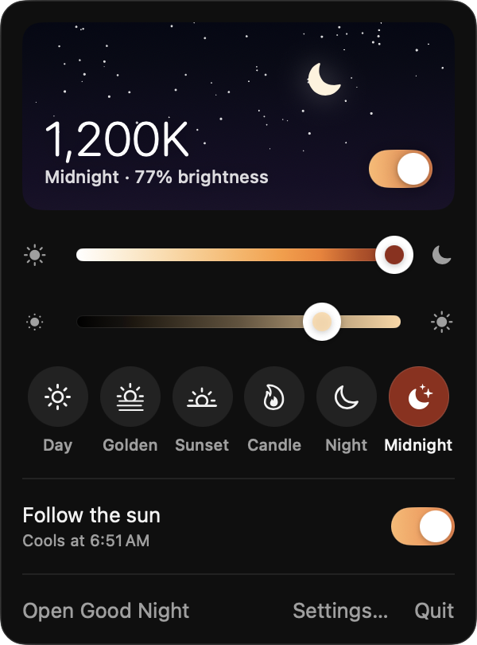
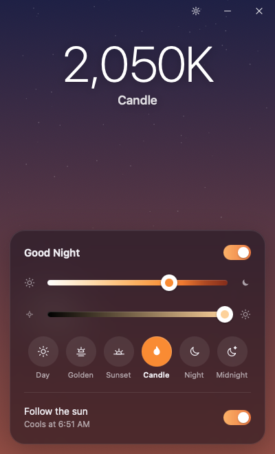
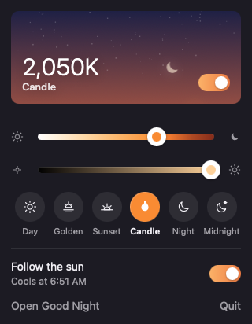

<p align="center">
  
</p>

<h1 align="center">Good Night</h1>

<p align="center">
  Warm your screen after sunset and dim it all the way to black.<br>
  A tiny, free app for macOS and Windows.
</p>

<p align="center">
  <a href="https://github.com/michael-berardi/goodnight/releases/latest">Download</a> ·
  <a href="#how-it-works">How it works</a> ·
  <a href="#build-from-source">Build from source</a>
</p>

## Install

- **macOS 13 or later, Apple silicon and Intel:** [Download the DMG](https://github.com/michael-berardi/goodnight/releases/latest/download/GoodNight-0.5.3-mac.dmg), open it, and drag Good Night to Applications.
- **Windows 10 and 11, x64 (preview):** [Download the installer](https://github.com/michael-berardi/goodnight/releases/latest/download/GoodNight-0.5.3-windows-x64-setup.exe) and run it. It requires administrator rights to enable the full colour range. The installer is not code-signed; only continue past SmartScreen if you trust the download.

Release checksums are in `SHA256SUMS` on [Releases](https://github.com/michael-berardi/goodnight/releases/latest). Open Good Night, choose **Candle**, then adjust brightness. Turn on **Follow the Sun** to schedule warmth automatically.

<p align="center">
  
  &nbsp;
  
</p>

<p align="center">
  
  &nbsp;
  
</p>

## Controls

- Warmth ranges from 6,500K to 1,200K, with six presets: Day, Golden, Sunset, Candle, Night and Midnight.
- Brightness dims supported displays in software, including external monitors, down to black. Relaunching starts at no less than 30% brightness.
- Follow the Sun warms over an hour around sunset and cools over 45 minutes around sunrise. Times use your time zone's reference city, not your location. Unknown zones use an estimate from the UTC offset; polar day and night use 07:00 and 19:00.
- On macOS, Settings control visibility in the menu bar and Dock. On Windows, closing the window leaves the app in the tray.

| Action | macOS | Windows |
|---|---|---|
| Warmer / cooler (global) | ⌃⌥⌘ → / ← | Ctrl Alt Shift → / ← |
| Brighter / dimmer (global) | ⌃⌥⌘ ↑ / ↓ | Ctrl Alt Shift ↑ / ↓ |
| Presets | ⌘1 – ⌘6 (app focused) | Tray flyout |
| Turn on or off | ⇧⌘T (app focused) | Tray menu |

If you dim to black, use the global brighter shortcut. Another app can prevent a shortcut from registering, so check it before dimming fully.

## How it works

Good Night changes display colour lookup tables rather than drawing an overlay. The shared Rust engine in `core/` calculates the warmth curve, schedule and settings; SwiftUI and Tauri provide the platform interfaces.

The curve uses a blackbody white-point approximation, keeps a small blue component, and reduces highlights more than shadows at deep-night settings. It transforms the captured display calibration curve. On Windows, unreadable curves or curves that already look tinted are replaced with a linear curve.

Presets and schedule changes fade over one second; sliders respond immediately. Display and driver support determine whether gamma changes work. Windows reports rejected changes in the window.

The Windows installer sets `GdiIcmGammaRange` to 256 under `HKLM\SOFTWARE\Microsoft\Windows NT\CurrentVersion\ICM`. Normal quit restores captured display curves; forced termination is not guaranteed to restore them.

## Updates

Background checks are on by default: Good Night checks for a newer stable release once a day, anonymously, and offers it with its release notes: **Install Update**, **Remind Me Later** or **Skip This Version**. Installing automatically is an opt-in, off by default. Turn checks off in **Settings › Updates**, which has both switches and **Check Now**, or with `GOODNIGHT_NO_UPDATE_CHECK=1`. Details: [docs/updates.md](docs/updates.md).

## Privacy

- No account, no telemetry, no usage data.
- One anonymous request a day to the signed release feed, with no identifier or version.
- Settings and update state stay on this device; stale temporary files and update records are swept at launch.
- Details: [PRIVACY.md](PRIVACY.md).

## Build from source

Run the shared engine tests from the repository root with Rust installed:

```sh
cargo test --manifest-path core/Cargo.toml -j4
```

The tests include parity against the original Swift engine in eight time zones. No app launch or display changes are needed.

**macOS:** install Xcode 26 or later and Rust, including the `aarch64-apple-darwin` and `x86_64-apple-darwin` targets. Generate the engine framework before building Swift:

```sh
cargo install --git https://github.com/michael-berardi/carapace --tag v0.1.0 cargo-carapace
cd macos
CARGO_BUILD_JOBS=4 scripts/build-core.sh
swift build -j 4
```

`macos/scripts/build.sh` packages a universal app in `macos/dist` and signs it with a Developer ID when available (otherwise ad-hoc). It is separate from the development build above. `macos/scripts/release.sh` additionally requires `NOTARY_PROFILE` and produces a notarized DMG and update feed.

**Windows:** install Rust, the [Tauri prerequisites and CLI](https://v2.tauri.app/), then run:

```sh
cd windows/src-tauri
cargo tauri build
```

Cross-building also requires `cargo-xwin` and NSIS: use `cargo tauri build --runner cargo-xwin --target x86_64-pc-windows-msvc`. `windows/scripts/release.sh` requires `TAURI_SIGNING_PRIVATE_KEY` and produces the installer and update feed in `windows/dist`.

## Layout

- `core/`: shared Rust engine and regression tests; the curve lives in `core/src/warmth.rs`.
- `macos/`: SwiftUI shell, display integration and packaging scripts. `GoodNightEngine.swift` is generated by `scripts/build-core.sh`; do not edit it by hand.
- `windows/`: Tauri shell, static web UI, display integration and installer scripts.
- `docs/`: icon, vector mark and screenshots.

## License

MIT. See [LICENSE](LICENSE).

---

Part of [Pareto Cybernetics](https://paretocybernetics.com/projects/goodnight/): free, private, open-source tools for working with AI agents.
